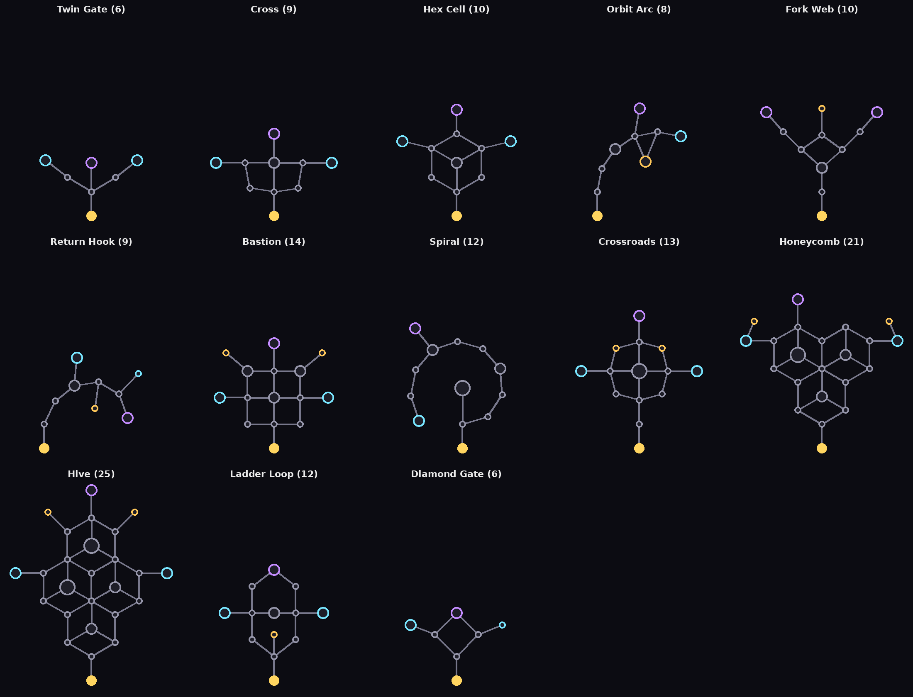

# Skill Tree for Brotato

An endless, Path of Exile style passive skill tree mod for [Brotato](https://store.steampowered.com/app/1942280/Brotato/).
Level-ups give skill points instead of the pick-one-of-four upgrade screen, and past the edge of
the tree, procedurally generated clusters keep it growing as far as you go.

**[Steam Workshop page](https://steamcommunity.com/sharedfiles/filedetails/?id=3839784217)** ·
**[Report a bug / suggest a feature](../../issues/new/choose)** · [Changelog](CHANGELOG.md)



## Features

- **105-node base tree** in 8 sectors (Vitality, Melee, Precision, Ranged, Elemental,
  Engineering, Fortune, Agility) with 16 notables and 8 keystones.
- **Endless frontier**: taking a keystone or frontier node places one of 13 geometric clusters
  (6–25 nodes). Orbit exits grow clusters *around* the tree, so deep paths can loop back and
  link into other sections.
- **Clusters follow your build**: new stats are weighted by the node you took, its neighbours
  and your overall investment, and every cluster has a "New direction" exit for reshaping.
- **Red crits**: crit chance past 100% rolls higher-magnitude crits (red, then purple overcrits).
- **Mechanized / Mutated / Cursed clusters** that scale with Evolution and Curse (DLC).
- Oddity capstones, named notables and rare relics with unique effects.
- Solo and local co-op (each player has their own tree), controller support, save/continue
  support, optional [Mod Options](https://steamcommunity.com/sharedfiles/filedetails/?id=3598984651) settings.

## Install

Subscribe on the [Steam Workshop](https://steamcommunity.com/sharedfiles/filedetails/?id=3839784217).

To test a local build, build the zip (below) and put it in a Workshop item folder, e.g.
`steamapps/workshop/content/1942280/<some item id>/`. The game only loads mods from Workshop
folders. Remove the test copy afterwards so the mod doesn't load twice.

## Repository layout

| Path | What it is |
|---|---|
| `mods-unpacked/blard-SkillTree/` | The mod (GDScript, Godot 3 / ModLoader 6.3) |
| `mods-unpacked/blard-SkillTree/skill_tree.gd` | Tree rules, state, frontier generation, red crit math |
| `mods-unpacked/blard-SkillTree/ui/skill_tree_screen.gd` | Full-screen tree UI |
| `mods-unpacked/blard-SkillTree/extensions/` | Hooks into the game (level-ups, shop, enemy damage, damage numbers) |
| `mods-unpacked/blard-SkillTree/tree_data.gd` | Generated base tree, from `tools/gen_tree.py` |
| `mods-unpacked/blard-SkillTree/patterns.gd` | Generated cluster patterns, from `tools/gen_patterns.py` |
| `tools/` | Python design tools: generators, validator, placement simulation, preview renderer |
| `workshop/` | Workshop description, preview image and change notes |
| `build.py` | Builds `dist/Skill Tree.zip` |

## Building and releasing

Requires Python 3 (the tools also need Pillow).

```
python tools/gen_tree.py          # only if you changed the base tree
python tools/gen_patterns.py      # only if you changed cluster patterns (validates first)
python build.py                   # -> dist/Skill Tree.zip
```

To release:

1. Bump `version_number` in `mods-unpacked/blard-SkillTree/manifest.json` and add a
   `CHANGELOG.md` entry.
2. `python build.py`, then test the zip in a Workshop folder.
3. Commit, tag (`git tag -a v1.x.y -m "Skill Tree 1.x.y"`), push with `--tags`.
4. Create a GitHub release for the tag and attach `dist/Skill Tree.zip`.
5. Upload with the Brotato Workshop uploader: same zip, **Workshop ID 3839784217**.
   Paste the new change notes on the Steam page.

## Reporting bugs

Please [open an issue](../../issues/new/choose) and attach your log:
`%APPDATA%\Brotato\logs\godot.log` (Windows). Say whether it was solo or co-op and which
other mods you use.

## License

[MIT](LICENSE). Brotato is © Blobfish; this repository contains only the mod's own code and assets.
